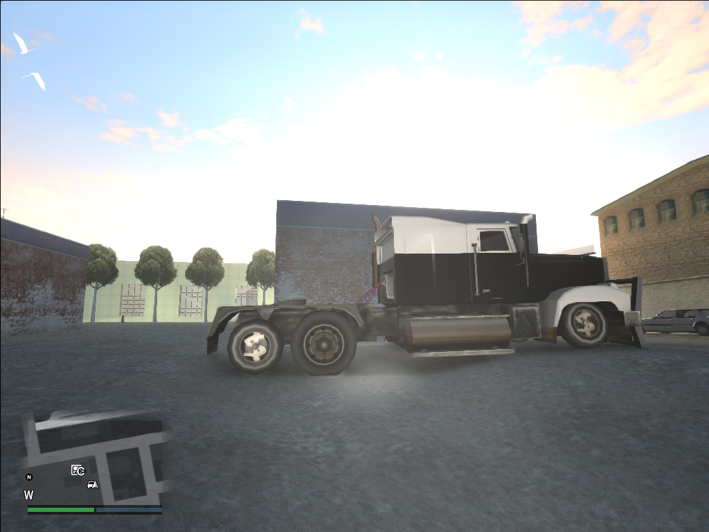
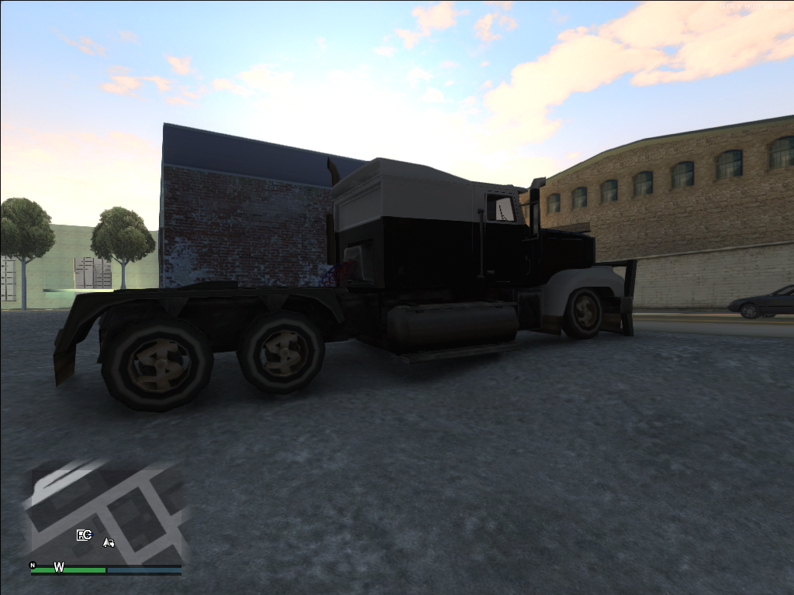

# sixwheel_fix

Grand Theft Auto San Andreas features six wheeler vehicles, like trucks and whatnot. SA:MP, Chaos Mod and whatever random customization mods are out there let you apply wheel mods to these. The game, however, never expected you to be able to do that, so it never actually changes the middle set of wheels. This mod fixes that.

## Download

[Releases](https://github.com/gaussandhisgun/sixwheel_fix/releases/latest)

## Before/After





## Build

Builds on Linux by running it as a shell script. I love mods that assemble themselves :D For anything else, whatever your local equivalent of this line is:

```bash
i686-w64-mingw32-g++ -std=c++17 -O2 -Wall -shared -static-libgcc -static-libstdc++ -fno-exceptions -fno-rtti -o sixwheel_fix.asi sixwheel_fix.cpp
```

-----

*The development of this mod was lightly LLM-assisted.*